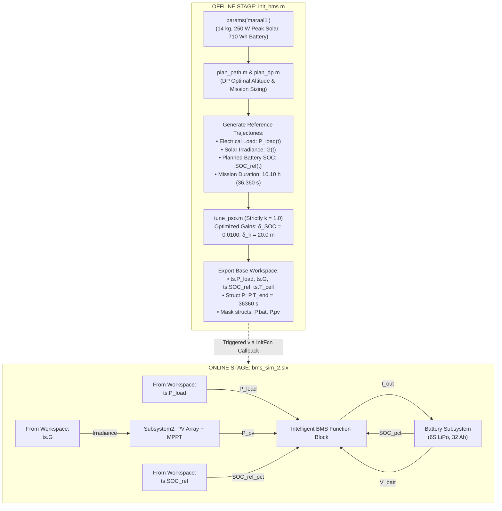

# MARAAL-1 Solar-Powered UAV: Intelligent BMS & Energy Management System (EMS)

## Project Overview

This project implements an **Intelligent Battery Management System (BMS)** and **Fast-Loop Energy Management System (EMS)** for the **MARAAL-1** solar-powered fixed-wing Unmanned Aerial Vehicle (UAV), developed based on research from **IIT Kanpur**.

The simulation integrates:
1. **Dynamic Programming (DP) Flight Path Planning**: Generates the globally optimal altitude profile to maximize end-of-flight battery state of charge (SOC).
2. **Aerodynamic Load Modeling**: Calculates real-time flight power demand based on International Standard Atmosphere (ISA) density variations and climb rates.
3. **Solar Physics Modeling**: Simulates clear-sky ($k = 1.0$) solar irradiance and photovoltaic generation over Kanpur ($26.45^\circ\text{ N}$) on April 15.
4. **Offline Particle Swarm Optimization (PSO)**: Automatically tunes the EMS error-normalization decision gains ($\delta_{SOC}, \delta_h$) specifically for clear-sky operations.
5. **Simulink System Simulation (`bms_sim_2.slx`)**: Simulates the physical Simscape battery pack (6S LiPo, 32 Ah), PV array (84 SunPower Maxeon C60 cells), boost MPPT converter, and the intelligent rule-based BMS logic block.

---

## System Architecture



---

## UAV Specifications (MARAAL-1)

| Parameter | Value | Description / Source |
| :--- | :--- | :--- |
| **Airframe Mass ($m$)** | $14\text{ kg}$ | Flight model mass (MTOW: $20\text{ kg}$) |
| **Wing Area ($S$)** | $2.209\text{ m}^2$ | Span $b = 5.35\text{ m}$, Aspect Ratio $AR = 13\text{--}14$ |
| **Cruise Speed ($V$)** | $15\text{ m/s}$ (design), $20\text{--}23\text{ m/s}$ (flown) | Level cruise power $\approx 200\text{ W}$ |
| **Battery Chemistry & Config** | LiPo, 6S ($22.2\text{ V}$ nominal) | $32\text{ Ah}$, Energy $E_{batt} \approx 710\text{ Wh}$ |
| **Battery Voltage Range** | $18.0\text{ V}$ to $25.2\text{ V}$ | $3.0\text{ V}$ to $4.2\text{ V}$ per cell |
| **Battery Current Limits** | Max Charge: $16\text{ A}$ ($0.5\text{C}$), Max Discharge: $50\text{ A}$ | Over-current & thermal protection limits |
| **Solar Array** | SunPower Maxeon C60 ($84\text{ cells}$) | 3 strings of 28 cells, $250\text{ W}$ peak clear-sky |
| **MPPT Tracking** | Boost Converter, $98\text{--}99\%$ efficiency | Temperature-compensated reference voltage |
| **Altitude Storage Corridor** | $1000\text{ m}$ to $3000\text{ m}$ | Approved flight test corridor used for DP planning |

---

## File Inventory & Status

| File Name | Role in Project | Status |
| :--- | :--- | :--- |
| **`init_bms.m`** | **Master initialization script**. Executes planning, PSO, packages time series, and configures base workspace for Simulink. | **Active (Primary)** |
| **`bms_sim_2.slx`** | **Main Simulink model**. Contains the physical battery, PV array, MPPT, and Intelligent BMS block. | **Active (Primary)** |
| **`params.m`** | Defines aircraft specifications, battery limits, and solar parameters for MARAAL-1. | **Active** |
| **`power_model.m`** | Aerodynamic drag and climb power model. Calculates electrical demand $P(h, \dot{h})$. | **Active** |
| **`solar_model.m`** | Meinel clear-sky solar irradiance $G(t)$ and electrical PV power $P_{pv}(t)$ model. | **Active** |
| **`plan_dp.m`** | Dynamic programming algorithm on time-layered grid for optimal altitude trajectory. | **Active** |
| **`soc_ref.m`** | Coulomb integration model for battery state-of-charge reference trajectory. | **Active** |
| **`plan_path.m`** | Complete mission profile generator (takeoff climb + DP cruise + landing glide). | **Active** |
| **`scenarios.m`** | Weather definitions (strictly clear-sky $k = 1.0$). | **Active** |
| **`tune_pso.m`** | Particle swarm optimizer for tuning EMS decision gains ($\delta_{SOC}, \delta_h$). | **Active** |
| **`sim_mission.m`** | Mission simulator used by PSO cost function during offline optimization. | **Active** |
| `clean_init_bms.m` | Legacy placeholder script with artificial step loads. | **Deprecated (Do Not Use)** |
| `run_plan.m` | Standalone script for DP path plotting. Redundant with `init_bms.m`. | **Optional / Reference** |
| `run_mission.m` | Standalone script for PSO tuning and scenario plotting. Redundant with `init_bms.m`. | **Optional / Reference** |

---

## Theory & Control Logic

### 1. Energy Storage in Altitude
Gravitational potential energy acts as a secondary energy buffer:
$$\Delta E_{pot} = m \cdot g \cdot \Delta h$$
- Climbing $1000\text{ m}$ on a $14\text{ kg}$ UAV stores $137.3\text{ kJ} \approx 38.1\text{ Wh}$.
- When midday solar generation exceeds motor demand ($P_{net} \ge 0$), excess energy is split between battery charging and climbing.
- In late afternoon ($P_{net} < 0$), descending at a controlled sink rate recovers potential energy, unloading the battery.

### 2. Intelligent Decision Variable ($d$)
The decision variable $d \in [-1, +1]$ normalizes battery and altitude errors:
$$w_S = \text{clamp}\left(\frac{\text{SOC} - \text{SOC}_{ref}}{\delta_{SOC}}, -1, 1\right)$$
$$d = \text{clamp}(w_S - w_H, -1, 1) \quad (\text{with } w_H = 0 \text{ when altitude is within tolerance})$$
- **$d > 0$ (Surplus State)**: Aircraft is ahead of the planned energy trajectory. Divert power into climbing ($f = \frac{1+d}{2}$).
- **$d < 0$ (Deficit State)**: Aircraft is below the planned energy trajectory. Conserve battery by gliding ($g = \frac{1-d}{2}$).

### 3. BMS Protection Logic
- **Discharge Protection**: If $\text{SOC} \le 20\%$ or $V_{batt} \le 18.0\text{ V}$, discharge is inhibited (`dis_ok = false`) until $\text{SOC}$ recovers above $25\%$.
- **Charge Protection**: If $\text{SOC} \ge 80\%$ or $V_{batt} \ge 25.2\text{ V}$, charging is inhibited (`chg_ok = false`) until $\text{SOC}$ drops below $77\%$.
- **Current Limits**: Maximum discharge current is clamped to $50\text{ A}$; maximum charge current is clamped to $16\text{ A}$ ($0.5\text{C}$).

---

## How to Run the Simulation

### Prerequisites
- MATLAB & Simulink (R2022b or later recommended, tested up to R2025a)
- Simscape and Simscape Electrical (Specialized Power Systems)

### Step-by-Step Execution

1. **Open MATLAB**:
   Set your current working directory to the project folder containing the `.m` files and `bms_sim_2.slx`.

2. **Initialize Workspace (Manual or Automatic)**:
   - **Automatic**: Opening `bms_sim_2.slx` and clicking **Run** automatically triggers `init_bms.m` via the model's `InitFcn` callback.
   - **Manual**: Run `init_bms` in the MATLAB Command Window:
     ```matlab
     init_bms
     ```

3. **Verify Command Window Output**:
     ```text
     =======================================================
      Initializing MARAAL-1 Intelligent BMS Simulation (k=1)
     =======================================================
     1. Executing DP Path Planner & Aerodynamic Load Model...
        - Planned Flight Duration : 10.10 hours (36360 s)
        - Takeoff Clock Time      : 6.00 h
        - Planned Landing Time    : 16.10 h
        - Peak Cruise Altitude    : 1000 m
        - Planned Landing SOC     : 43.7%
     2. Tuning EMS Decision Gains [delta_SOC, delta_h] via PSO (k=1 only)...
        - Optimal Gains: delta_SOC = 0.0100 (1.00%), delta_h = 20.00 m (Cost J = 0.575)
     3. Constructing Simulink Timeseries Structures...
     =======================================================
      Initialization Complete! Ready for Simulink Execution.
      Simulation StopTime set to P.T_end = 36360 s (10.10 hours)
     =======================================================
     ```

4. **Run Simulation**:
   - Open `bms_sim_2.slx`.
   - Verify that **Stop Time** is set to `P.T_end`.
   - Click **Run ($\blacktriangleright$)**.
   - Open the scopes (`V_batt`, `I_bat`, `soc`, `ppv`, `flags`) to observe real-time system performance.

---

## Implementation Details & Troubleshooting

### Self-Contained MATLAB Function Blocks (Fix for Simulink Coder Struct Error)
Simulink MATLAB Function blocks enforce strict Coder typing. Accessing base workspace structs via `P.property` causes Coder compilation errors (*"Unable to extract field from variable of type double"*). 

To ensure zero-error compilation:
- **`BMS` Block**: Uses local constants for physical limits (`eta_conv = 0.96`, `SOC_min = 0.20`, `SOC_max = 0.80`, `V_UV = 18.0`, `V_OV = 25.2`, `I_chg_max = 16.0`, `I_dis_max = 50.0`, `delta_SOC = 0.0100`, `delta_h = 20.00`). The dynamic reference trajectory is passed via input port `SOC_ref_pct` connected to `ts.SOC_ref`.
- **`Subsystem2/MATLAB Function` (MPPT)**: Uses local constants for the SunPower Maxeon C60 array (`Ns = 28`, `Vmp = 0.582`, `kVmp = -0.0035`).
- The parameter `P` has been removed from the block arguments and the **Ports and Data Manager** for both blocks.

---

## References

1. V. S. Dwivedi, J. Patrikar, A. Addamane, and A. K. Ghosh, *"MARAAL: A Low Altitude Long Endurance Solar Powered UAV for Surveillance and Mapping Applications,"* IIT Kanpur.
2. V. S. Dwivedi, *"Development of a Solar UAV Using Novel Design Features and Optimal Energy Management Techniques,"* Ph.D. thesis, Department of Aerospace Engineering, IIT Kanpur, 2021.
